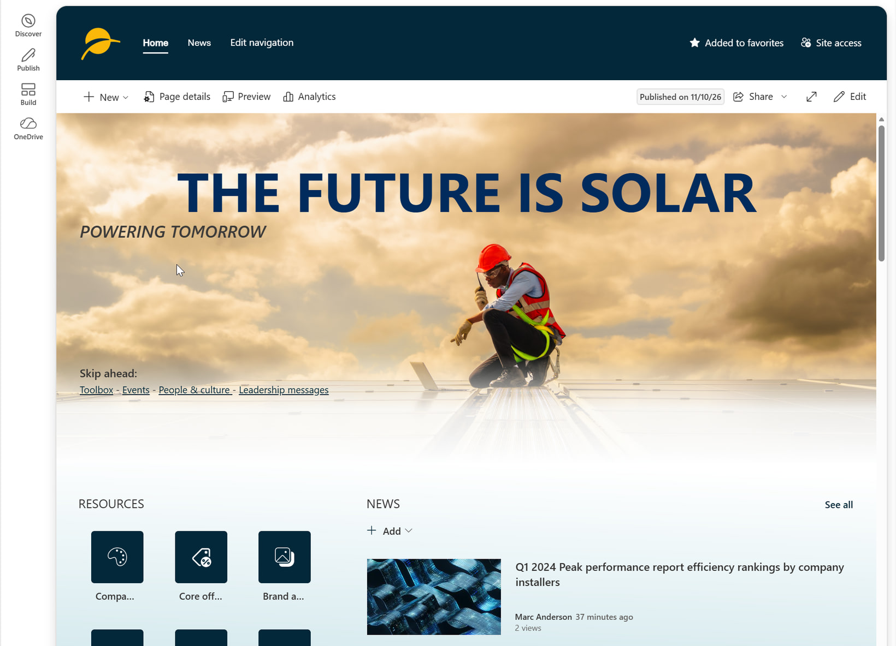
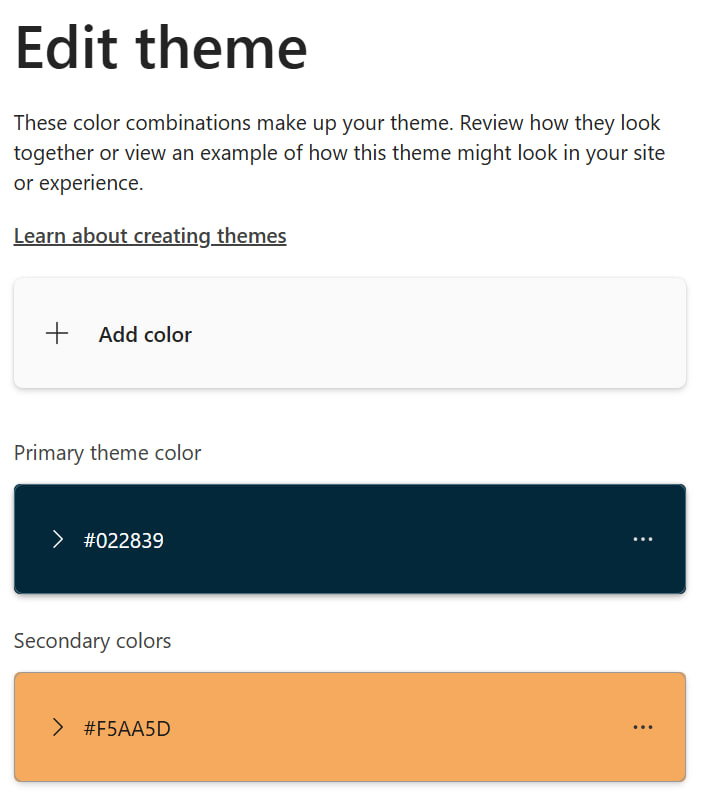
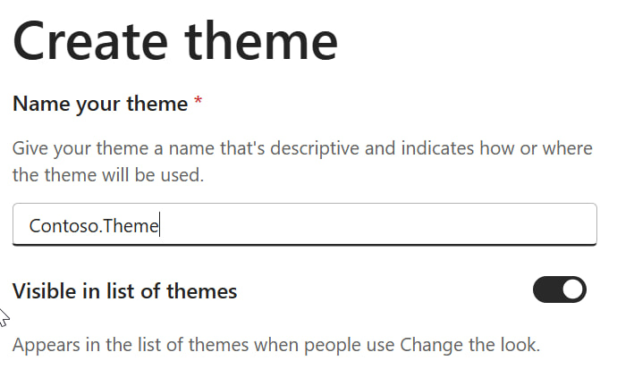
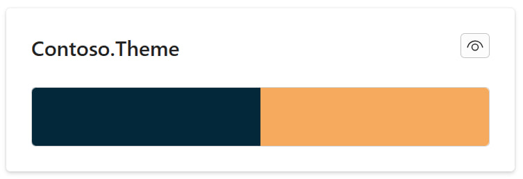
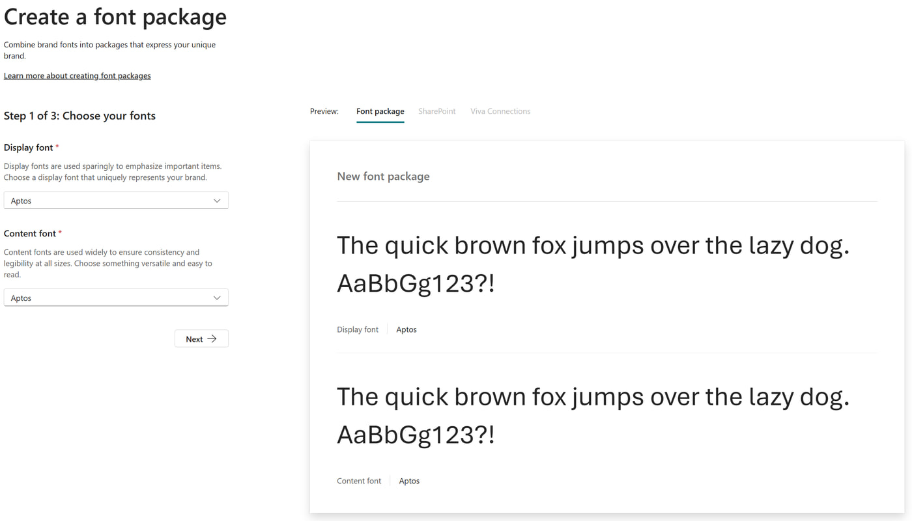
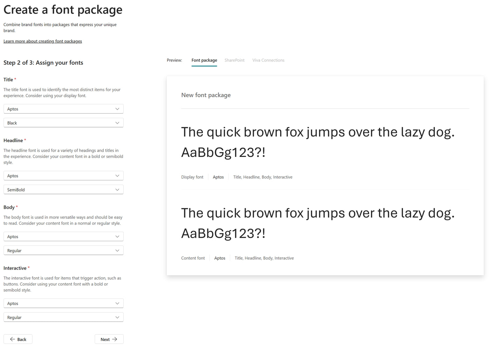
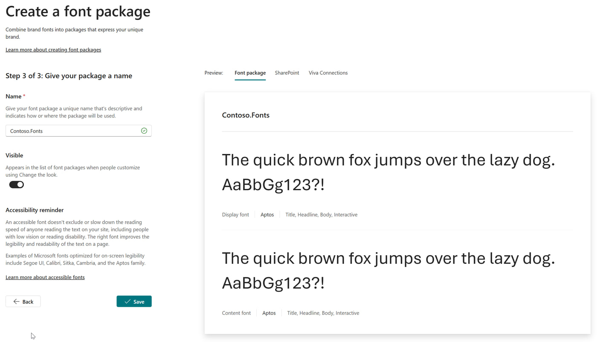
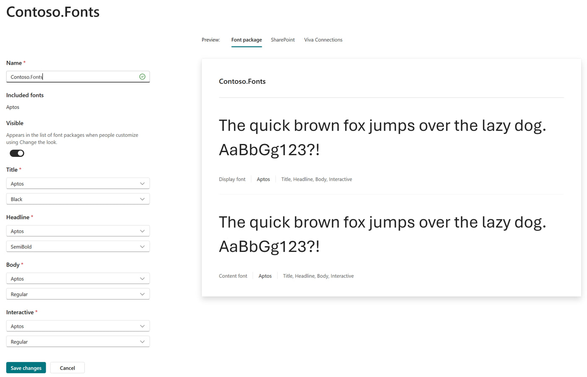
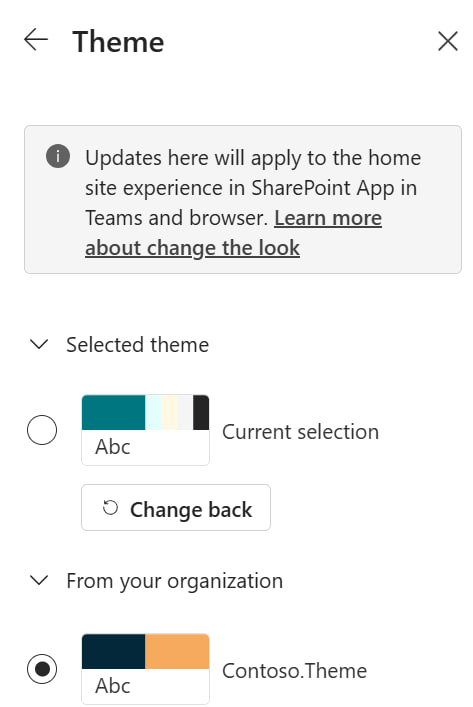
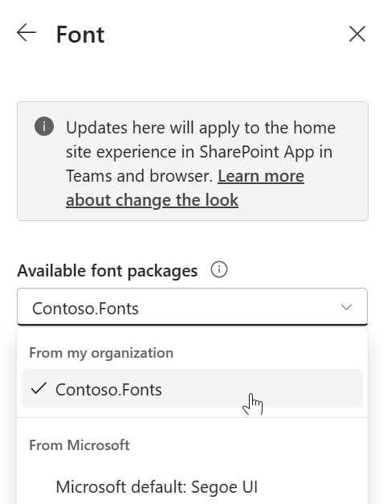

# Installation Instructions

These installation instructions are streamlined as much as possible, with the goal to get you from start to finish as quickly as possible. If you encounter a topic with which you are not familiar, the instructions link out to Microsoft Learn articles with more specifics.

Installing the Contoso site requires several steps:

- Create a new Communication Site in your tenant
- Create the Viva Connections experience for the site
- Run the PowerShell script to apply the PnP Provisioning template and set additional configurations
- Configure the Brand Center
- Configure the Contoso site settings which can't be automated



## Prerequisites

Before running the provisioning script, install [PowerShell](https://learn.microsoft.com/powershell/scripting/install/installing-powershell) and [PnP.PowerShell](https://pnp.github.io/powershell/articles/installation.html). Use a PowerShell version supported by your installed PnP.PowerShell module; Windows PowerShell 5.1 is not supported.

You also need an [Entra ID application registration for PnP.PowerShell interactive login](https://pnp.github.io/powershell/articles/registerapplication.html), with administrator consent for the delegated SharePoint permissions required by the provisioning commands. Set `$clientId` in the script to your application's client ID, and update `$tenant` and `$siteUrl` for your environment. The sample values are not intended for your tenant.

For most of these instructions, you should have the SharePoint Admin role. While some steps can be accomplished by the Site Owner, it will be most expeditious to follow all the instructions with the SharePoint Admin role.

Any exceptions to the above (for example, where Global Administrator permissions are required) are noted in each step.

## Prepare

### Create a new Communication Site

Create a new Communication Site named *Contoso*, using the default template. If you need instructions to create this site, please refer to the support article [Create a communication site in SharePoint](https://support.microsoft.com/office/create-a-communication-site-in-sharepoint-7fb44b20-a72f-4d2c-9173-fc8f59ba50eb).

Be sure to make yourself the Site Owner of the Communication Site. You can add additional Site Owners or Site Members now or later in the site itself.

Throughout the rest of these instructions, you will be either making changes to this site or setting up artifacts in other locations which will support this site, its branding, and its functionality.

### Create the Viva Connections experience for the site

You will need to create a Viva Connections experience for the site you've just created if you'd like to have the Dashboard and Resources displaying properly. For detailed instructions, see [Set up Viva Connections in the Microsoft 365 admin center](https://learn.microsoft.com/viva/connections/set-up-admin-center). This is a long article, but you don't need to follow all the steps. You'll want to choose the option to `Build from an existing portal to set a home site`. This will make the Contoso site a home site for your tenant.

The provisioning script adds the ACEs to the Dashboard for the site and sets up the links in the Resources Web Part. Prior to running the provisioning script, you will need to create the experience in order for them to be visible.

If you'd like step-by-step instructions which focus only on the required steps here, see the article [Set up Viva Connections for the site](/_common/setup-viva-connections.md).

Before you continue, create the Dashboard for the site by navigating to the gear in the upper right corner of the site, and selecting **Manage home site** and then **Create dashboard**. (You won't see this option if you haven't enabled the Viva Connections experience.)


This will create the Dashboard.aspx page in the site and also set up some of the underlying plumbing, which is required for the provisioning script to run successfully.

Finally, publish the *Dashboard.aspx* page. You don't need to add any cards to it; the provisioning script will take care of that.


### Download ZIP file

Download the [Contoso ZIP file](./Contoso.zip). This ZIP file contains all the necessary files to apply the PnP Provisioning template, as well as the images and fonts used in the site.

### Extract all files in ZIP file

We recommend you extract the ZIP file into a folder in the root of your machine, for example */code/Contoso*. This will ensure that the folder paths won't be too long for the script to run successfully.

>Note: The ZIP file contains additional files, should you want to automate more of the implementation. These files can also be used as documentation for the process, in addition to these instructions.

Ready to provision the Contoso artifacts!

## Apply PnP Provisioning template

The base definition for the site is contained in the PnP Provisioning template file. This file can be found in the folder *PnPProvisioning*, and is named *PnP-Provisioning-Clean.xml*. The folder also contains the images and other files which are referenced in the template.

The script *ApplyPnPProvisioningTemplate.ps1* applies the PnP Provisioning template to the site you have created above. The script also performs some additional configuration which cannot be contained in the PnP Provisioning template for technical reasons.

The template contains information about the lists and libraries, pages, and images contained in the site.

To run the script, open PowerShell 7 in the template folder and pass your tenant name (without `.onmicrosoft.com`), the App (client) ID of your PnP.PowerShell app registration, and the URL name of the site you created (the part after `/sites/`):

```powershell
.\ApplyPnPProvisioningTemplate.ps1 -Tenant "contoso" -ClientId "<your-app-id>" -SiteUrl "<site-url-name>"
```

For detailed instructions, see [Applying PnP Templates to SharePoint Sites](https://learn.microsoft.com/sharepoint/dev/solution-guidance/applying-pnp-templates).

You will be asked to log in with your credentials twice, once to connect to the SharePoint Admin Center to ensure the site you specified exists, and a second time to connect to that site. Then the script will run through several steps, applying the template and making the additional configurations.

If you see yellow information or warning messages, these are not errors, and the script should continue to run successfully. If you see red error messages, please [create an issue](https://github.com/pnp/SharePoint-Portal-Templates/issues).

## Configure Brand Center

In order for the site to look like what you see in the screenshots, you'll need to make a set of configurations in the Brand Center. We've made sure to suggest naming conventions which allow you to easily identify where the configuration settings have come from and how they are used, specifically with prefixes which reflect the demo site's name.

If your tenant does not have a Brand Center already, see the article [SharePoint brand center](https://learn.microsoft.com/sharepoint/brand-center-overview). Setting up a Brand Center requires Global Administrator permissions.

If you already have a Brand Center, the default location is */sites/BrandGuide*, though yours may be in a location you chose when you set it up.

### Create theme colors

For this site, you should add the following colors into your Brand Colors. Each is prefixed with the name of the site so you can identify them easily. 

>Note: There is no way to remove Brand Colors in the UI, though you can do so with PowerShell. For detailed instructions, see [Brand Colors](https://learn.microsoft.com/sharepoint/brand-colors).

| Color Name | Color Code | Color |
|---|---|---|
| Contoso.Blue | #022839 |  |
| Contoso.Peach | #F5AA5D |  |
| | | |

### Set up theme

Once you have the Brand Colors defined, you use them to set up a theme. For detailed instructions, see [Site theme](https://learn.microsoft.com/sharepoint/site-theme).

#### Add the theme colors

First, you add the colors to the theme. Add the colors in the order listed above.



#### Name the theme

Next, give the theme the name *Contoso.Theme*, and Save.



#### Review the theme

Finally, the theme should look like this if you have set it up correctly.


### Upload fonts

The site uses several custom fonts to enhance its look and feel. You need to upload specific font files to support the site. These font files are not prefixed. For each font family, you need to upload a set of font files, each of which contains variants on the font for use in the Font Package, which we will create next. For detailed instructions, see [Brand Fonts](https://learn.microsoft.com/sharepoint/brand-fonts).

Contoso uses the custom font *Aptos*. The appropriate files are in the *Fonts* folder.

### Create Font Package

Font Packages combine sets of fonts for use in a site which has the Font Package enabled. For detailed instructions, see [Font packages](https://learn.microsoft.com/sharepoint/brand-center-font-packages).

| Font Slot | Font Name | Font Variant |
|---|---|---|
| Title | Aptos | Black |
| Headline | Aptos | SemiBold |
| Body | Aptos | Regular |
| Interactive | Aptos | Regular |
| | | |

#### Choose your fonts



#### Assign your fonts



#### Give your package a name

Name the font package *Contoso.Fonts*, and Save.



### Review font package

Review the settings to ensure you have created the Font Package correctly.



## Final site configuration

These final steps apply the configurations you have set up above in the site itself.

### Change the look

Go to the gear, and select Change the look.

The provisioning script sets the header layout to Standard. Configure a background image overlay under Header so the background image is displayed.

#### Apply theme

Select Theme and choose the `Contoso.Theme` and Save.



#### Apply Font Package

Enable the Font Package you created above under Fonts.



#### Set footer alignment

After applying the provisioning template, select Footer under Change the look, set the alignment to Left, and select Save.

#### Set header image overlay

After applying the provisioning template, select Header under Change the look, choose a background image overlay color and a nonzero overlay opacity, and select Save.

## Summary

At this point, you should have a fully functioning Contoso site, with the theme and fonts applied. You can continue to customize the site as you see fit, adding additional content, pages, and web parts to make it your own.

If you've had problems setting up the site, please [create an issue](https://github.com/pnp/SharePoint-Portal-Templates/issues) in the GitHub repo, and we will do our best to assist you.


